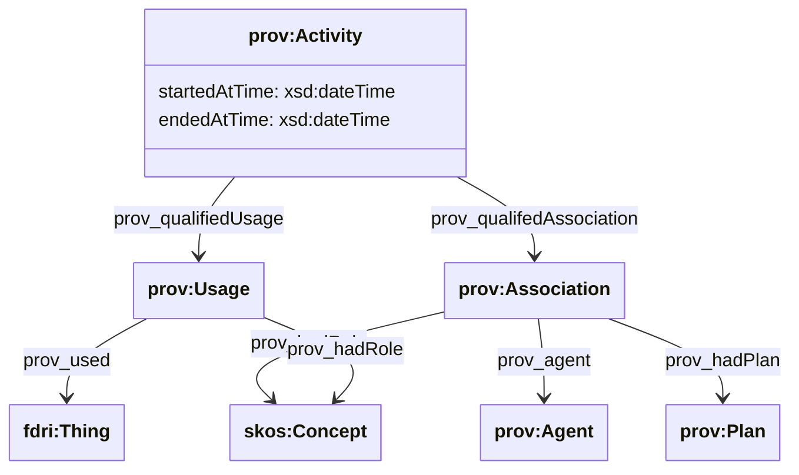
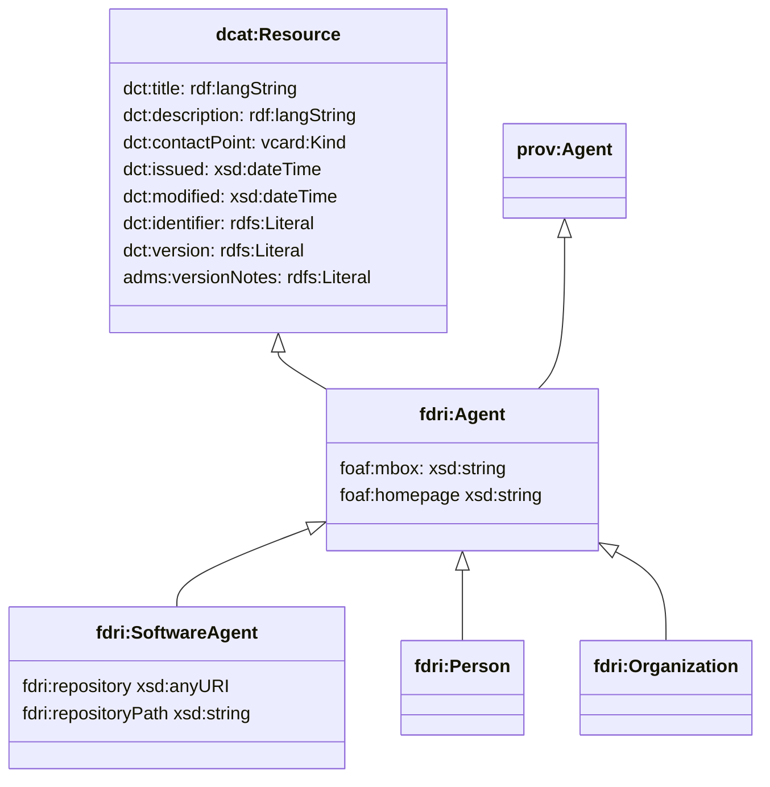
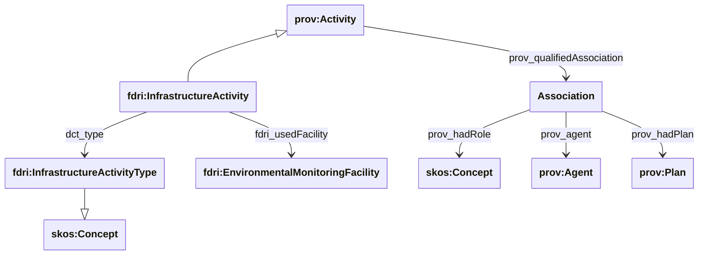
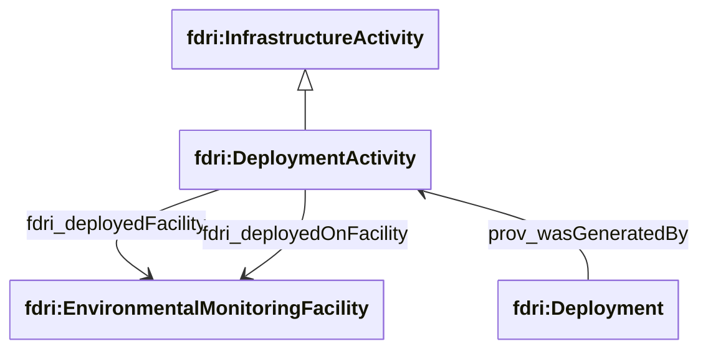
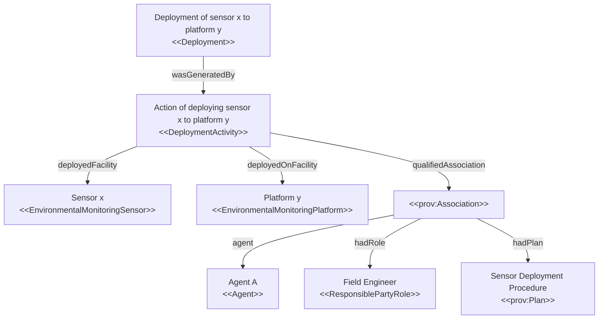
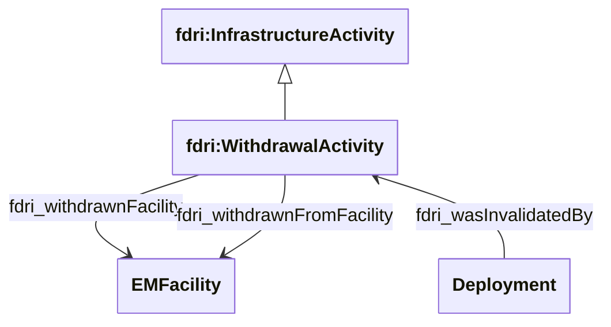
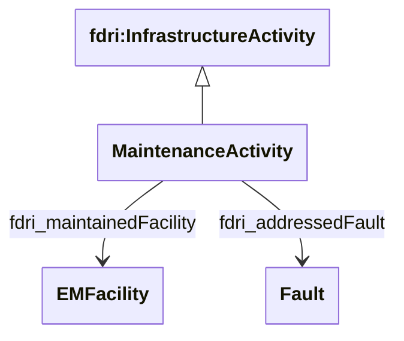
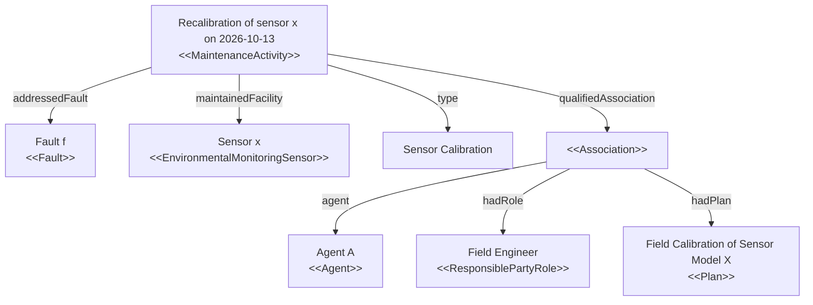

## Provenance and Activity Model

The FDRI model uses the PROV-O ontology to record details of activities, their inputs and their outputs.
Activities related to datasets would include processes such as data ingestion, quality checking, quality improvement, statistical derivation and so on. Activities can also be related to other assets, e.g. the installation of an sensor at a site, the repair or replacement of an instrument, the decommissioning of a monitoring platform and so on.

PROV-O allows activities to be related to the entities involved in the activity either through a "qualified" or an "unqualified" relationship. An unqualified relationship is represented as a direct property on the activity that references the entity - e.g. `prov:used` indicates that the entity that is the object of the statement was used in some way during the execution of the activity that is the subject of the statement.
A qualified relationship is a separate resource that represents the relationship itself. The primary advantage of a qualified relationship is that detailed information about the nature of the relationship can be captured. For example, in what way the entity was used by the activity.

Given that supporting multiple forms of representation can lead to some complex queries, we recommend using the qualified relationship approach at all times. To this end, the schema version of the FDRI model supports only the `prov:qualifiedUsage` and `prov:qualifiedAssociation` properties on an Activity.

The diagram below shows the structure for activities that is supported by the FDRI schema.

> **NOTE**
> In situations where the ingest is streaming/near-realtime it might make sense to have an open-ended Derivation and Ingest Activity which are only ended when the stream is closed or the ingest software agent updated. If so then it might be worth adding a notion of a run log (timestamp and log pointer) structure that can be appended to an open activity for each run instance.

### PROV-O extension properties

PROV-O defines entity to activity relations only for generation(`prov:wasGeneratedBy`) and invalidation(`prov:wasInvalidatedBy`). To model the case where an activity extends or otherwise modifies an existing dataset without creating a new dataset instance, we add `fdri:wasModifiedBy` as a sub-property of `prov:wasInfluencedBy`.

### Model for Agents

The model for agents is deliberately kept simple and inherits from `dcat:CatalogResource`. By implication, the metadata catalog will track individual agents that are involved in activities that update catalog resources.

> **QUESTION**
> The assumption made here is that the metadata store is required to track information for both software agents *and* people and organisations and that this will be done by treating all such agents as resources in the metadata catalog. Is this a valid assumption, or do we in fact only need to track software agents as catalog resources - in which case we can use prov:Person and prov:Organisation directly and don't need the `fdri` namespaced types.

Note that `dcat:Resource` already has a property (`dct:contactPoint`) which can be used to capture contact details for `prov:Person` and `prov:Organization` resources.

`dcat:Resource` also provides a `dct:version` property which can be used to capture the version of a software agent as well as `dct:issued` and `dct:modified` for tracking when a software release was made, and `adms:versionNotes` for capturing software release notes. We add the `fdri:repository` property to provide an explicit property for capturing a link to a version control repository.

If additional software agent metadata should be captured, this model could be extended but it should be noted that each additional piece of metadata will need to be reported through to the metadata system by the workflow system, and assuming an appropriate version control system is already in place for managing software versions and releases, we should not be seeking to replicate all of that metadata in the FDRI catalog.

### Model for Software Agent Configuration

The configuration used by an agent for an activity is captured by the `prov:hadPlan` property on the `prov:Association` resource. The modelling for software agent configurations is discussed in more detail in [Data Processing Configurations](data-processing-configurations.md).

### Model for Infrastructure Activities

An `fdri:InfrastructureActivity` represents an activity that affects an `fdri:EnvironmentalMonitoringFacility`.

The property `fdri:usedFacility` is a sub-property of `prov:used` and relates the activity to the facility or facilities used in or otherwise changed by the activity.

The property `dct:type` relates an `fdri:InfrastructureActivity` to an `fdri:InfrastructureActivityType` which is a `skos:Concept` that defines the kind of activity being carried out.

Amongst the properties inherited from `prov:Activity` is `prov:qualifiedAssociation` which relates the activity to an `prov:Agent` that was involved in the activity, a `skos:Concept` that defines the role played by the agent in the activity, and a `prov:Plan` which defines the procedure followed by the agent in executing the activity.

The `fdri:InfrastructureActivity` class is then extended to provide more specific sub-classes for particular kinds of activity. The subclasses proposed are:

* [DeploymentActivity](#deploymentactivity) for the deployment of systems
* [WithdrawalActivity](#withdrawalactivity) for the withdrawal of deployed systems
* [MaintenanceActivity](#maintenanceactivity) for activities related to the maintenance of facilities, optinally with reference to a fault.
* [CommissioningActivity](#commissioningactivity) for the commissioning of a facility
* [DecommissioningActivity](#decommissioningactivity) for the decommissioning of a facility

> **QUESTION**
> Are there other high-level infrastructure activities to add here?
> See also notes below about whether CommissioningActivity and DecommissioningActivity should be subclasses or just soft types.

#### DeploymentActivity

The class `fdri:DeploymentActivity` represents activities that result in the deployment of one or Environmental Monitoring Facilities into the field. These activities can be used as the trigger the start of an `fdri:Deployment` (represented by a `prov:wasGeneratedBy` property relating an `fdri:Deployment` to an `fdri:DeploymentActivity`).

The properties `fdri:deployedFacility` and `fdri:deployedOnFacility` are both sub-properties of `fdri:usedFacility`, and relate the activity to the facility or facilities being deployed and optionally to the facility to which they are being deployed.

##### Example of DeploymentActivity

The following diagram shows how this model can be used to capture the deployment of a sensor to a platform by an engineer. The responsibility of the engineer is captured as is the procedure used.

#### WithdrawalActivity

The class `fdri:WithdrawalActivity` represents activities that result in the withdrawal of one or more previously deployed facilities. These activities can be used as the trigger for the ending of an `fdri:Deployment`, as represented by the `prov:wasInvalidatedBy` property relating the `fdri:Deployment` to the `fdri:WithdrawalActivitiy`.

The properties `fdri:withdrawnFacility` and `fdri:withdrawnFromFacility` are both sub-properties of `fdri:usedFacility`, and relate the activity to the facility or facilities that were withdrawn and optionally to the facility that they were removed from.

The structure of this model is deliberately analogous to that used for the DeploymentActivity type.

> **QUESTION**
> Should there also be a "ReplacementActivity" activity to cover the replacement of a sensor or is it OK/preferable to model this as separate withdrawal and deployment activities?

#### MaintenanceActivity

The class `fdri:MaintenanceActivity` represents activities that involve the maintenance or upkeep of one or more facililties. The `dct:type` property of `fdri:Infrastructure` can be used to qualify the kind of maintenance activity being carried out.

The property `fdri:maintainedFacility` is a sub-property of `fdri:usedFacility` and relates the activity to the facility or facilities that were affected by the maintenance.

The property `fdri:addressedFault` can be used to relate the activity to the fault(s) that the activitiy was intended to correct. Note, we may use a different relationship to represent whether the fault was corrected by this activity. The intent of this relationship is simply to associate the activity as being part of the fault history.

##### Example of MaintenanceActivity

The following diagram shows how this model can be used to capture the recalibration of a sensor in the field in order to address a reported fault. The agent carrying out the work and the procedure that they used is also captured through wht qualified association.

#### CommissioningActivity

The class `fdri:CommissioningActivity` represents activities that commision a facility in the field. This kind of activity generally relates to an `fdri:EnvironmentalMonitoringPlatform` or `fdri:EnvironmentalMonitoringSite` and results in the facility's operational period starting.

> **QUESTION** Should this be a separate subclass, or do we just use soft-typing as it does not involve multiple facilities with different roles.

#### DecommissioningActivity

The class `fdri:DecommissioningActivity` represents activities that decommision a facility in the field. This kind of activity generally relates to an `fdri:EnvironmentalMonitoringPlatform` or `fdri:EnvironmentalMonitoringSite` and results in the facility's operational period ending.

> **QUESTION**: As with CommissioningActivity, this could be soft-typed.
